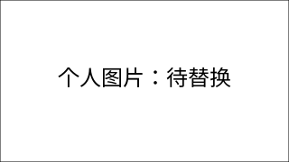

# 我的实验仓库

## 自我介绍

- 姓名：待填写
- 班级：待填写
- 学号：待填写
- 兴趣：待填写

## 图片



请将占位图片替换为自己的图片。

## 已完成作品

| 实验 | 内容 | 状态 |
| --- | --- | --- |
| lab0 | C++ Hello World | 已完成 |
| lab1 | 待填写 | 未开始 |
| lab2 | 待填写 | 未开始 |

## 编译运行

在仓库根目录执行：

```sh
g++ lab0/main.cpp -o lab0/hello.exe
./lab0/hello.exe
```

输出：你好……

## Git 练习

主分支练习：更新 README 内容。

