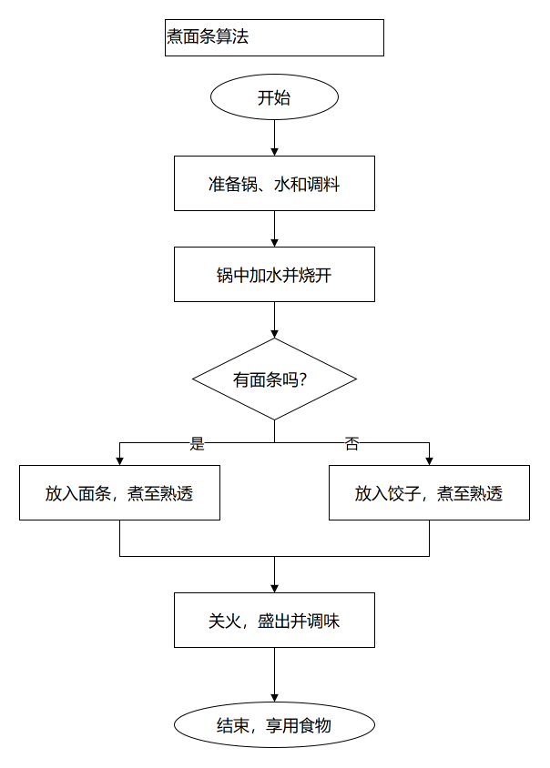

# 我的实验仓库

## 自我介绍

- 姓名：刘明一
- 班级：待填写
- 学号：待填写
- 年龄：十八岁
- 家乡：山东济宁
- 兴趣：听歌

## 图片



算法：准备锅、水和调料 → 将水烧开 → 有面条就煮面条，否则煮饺子 → 煮熟后关火，盛出调味。

[算法步骤](lab1/algorithm.md) · [可编辑流程图](images/cooking-flow.drawio) · [流程图 PNG](images/cooking-flow.png)

## 已完成作品

| 实验 | 内容 | 状态 |
| --- | --- | --- |
| lab0 | C++ Hello World | 已完成 |
| lab1 | 煮面条算法与条件流程图 | 已完成 |
| lab2 | 待填写 | 未开始 |

## 编译运行

在仓库根目录执行：

```sh
g++ lab0/main.cpp -o lab0/hello.exe
./lab0/hello.exe
```

输出：

```text
你好……
我叫刘明一，今年十八岁，来自山东济宁，平时喜欢听歌。
```

## Git 练习

主分支练习：更新 README 内容。
分支练习：补充 README 内容。

已合并 readme-update 分支，保留两边内容并解决冲突。
